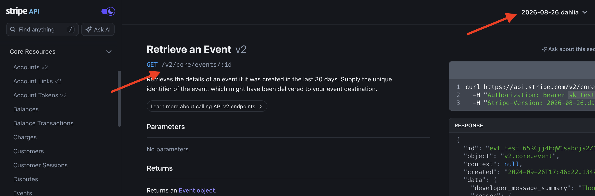
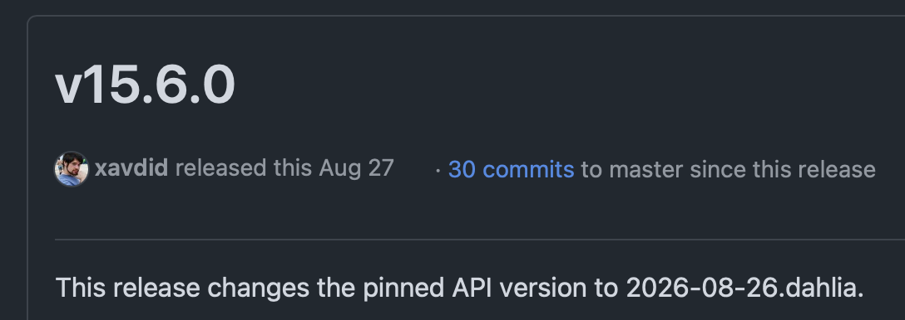
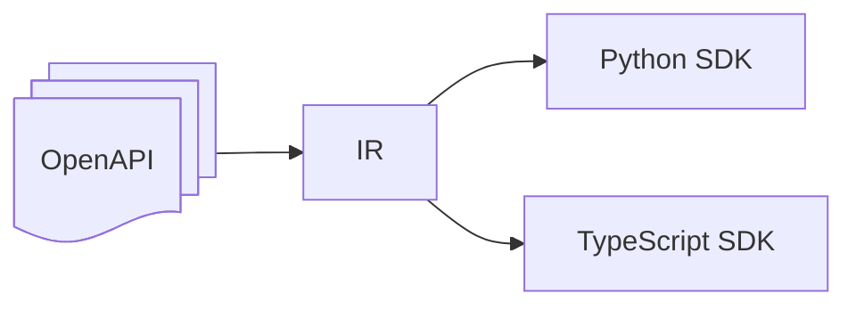
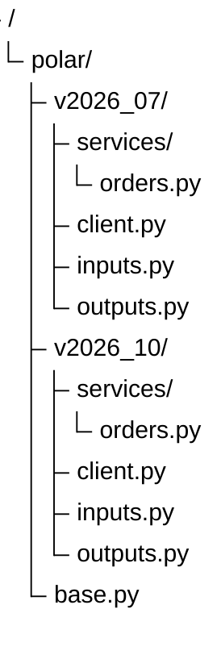
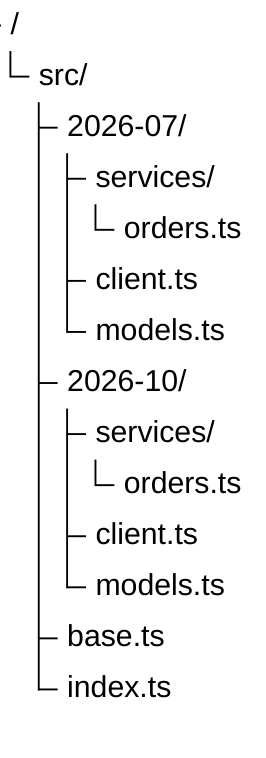

# You don't need /v2: API Versioning with FastAPI

> Introduce the topic of API versioning. Tell the story of how we started growing an API at Polar, tweaking it and changing it over time. We called a field `user_id`, and then realized it should be `customer_id`. But at that moment, we actually had users depending on it. We have a problem.

---


> I'm François, engineering lead at Polar. This is a problem we ran into as our API grew, and today I'll show you how we approached it with FastAPI.

---

# The "non-breaking" changes

```py
class OrderResponse(BaseModel):
    id: UUID4
    customer_id: UUID4
    user_id: Annotated[UUID4, Field(deprecated="Use customer_id")]
```

> Tell a story about how you start trying to introduce non-breaking changes and backward compatibility layers. But when can you remove them? Probably never. It feels like the simplest solution, until it gets out of control. It doesn't give users a reason—or a deadline—to migrate. Users start to ask for guarantees and clear deprecation policies.


---

# The /v2 solution

```
GET https://www.googleapis.com/drive/v2/files
GET https://www.googleapis.com/drive/v3/files
```

> The first approach to solving that is to introduce versioning at the path level. It is simple and clear. But renaming one field shouldn't require a new URL namespace for the whole API. We wanted to keep the same routes and declare only what changes between versions.

---

# The Version header

```
GET https://api.github.com/zen
X-GitHub-Api-Version: 2026-03-10
```

> Another common approach is to use a header to specify the version. The main benefit for users is that they can use the same set of endpoints and choose a dated API contract. But the header is the easy part. How do we maintain those contracts, document them, and carry them into our SDKs?

---

# And then you have Stripe



> Show a slide illustrating that Stripe has both `/v2` endpoints and its Stripe-Version header. Use it for comic effect after that introductory part. It shows that API versioning is actually a hard problem, because it's a delicate balance between technical constraints, stability and user experience.
> Let me show you how we solved it at Polar, and how we can do it with FastAPI.

---

# North Star

1. Declare changes with minimal duplication
2. Publish an accurate OpenAPI contract for every version
3. Let SDK users migrate at their own pace

> Here was our North Star. The key thing for us was that we wanted to maintain our pace of innovation, but still have a clear and stable contract for our users who rely on us for their billing.
> It meant we needed specific tooling, pushing the boundaries of FastAPI and Pydantic, so we could slightly tweak schemas or endpoints and serve several OpenAPI versions.
> And finally, given that we target quarterly releases, we wanted to give our users a way to keep track of the changes and migrate at their own pace, with type-safe SDKs that ship multiple versions.

---

# Introducing APIVersion

```py
@dataclasses.dataclass(frozen=True, order=True, slots=True)
class APIVersion:
    year: int
    month: int

V2026_07 = APIVersion(year=2026, month=7)
V2026_10 = APIVersion(year=2026, month=10)
```

> First, a version is just a year and a month. We make it immutable and comparable, and give each release a named constant. A context variable tells our versioning code which API version we're working with, without passing it through every function. For a request, we set it from the header. When generating documentation, we set it to the version we want to document. The field annotations use the same mechanism in both cases.
> For these examples, I’ll use July and October—two consecutive quarters. In our actual rollout, the older version was April, which we assigned retroactively to the existing API.
> Now we can declare when a field or an endpoint exists.

---

# Declaring field versions

```py
class OrderResponse(BaseModel):
    id: UUID4
    customer_id: Annotated[UUID4, Version(starting_from=V2026_10)]
    user_id: Annotated[UUID4, Version(up_to=V2026_07)]
```

> Here July clients see `user_id`; October clients see `customer_id`. But for us, it's the same single model.
> Version is a custom annotation that hooks into Pydantic's schema generation. It checks the selected version in context, compares it with the defined range, and raises `PydanticOmit` if the field is not part of the selected version. The schema is modeled dynamically according to the version in context.
> It also makes sure to skip it during serialization, so the field is not present in the response.
> Of course, we still need to be able to resolve old properties from our backend, but that's part of the compatibility layer.

---

# Declaring endpoint versions

```py
@router.post("/orders/")
@version(starting_from=V2026_10)
async def create_offline_order() -> OrderResponse:
  ...
```

> In this case, this create order endpoint is only available for October clients and beyond.
> This version decorator hooks into two things:
>
> 1. FastAPI schema generation. Basically, we call `get_openapi` manually and pass it the routes that have been filtered to include only those that are part of the selected version.
> 2. Starlette routing. If you try to reach an endpoint that doesn't exist in the requested version, you should get a 404. For that, we subclassed APIRoute to extend route matching with a check against the selected version.
>
> There are quite a lot of implementation details involved in making this work, so I won't go into them here, but I'm happy to share more after the talk.
>
> We can now declare a change once and serve the right response to each client. Next, how do we make sure the documentation describes exactly what that client receives?

---

# Serving several OpenAPI versions

```py
app = FastAPI(openapi_url=None)

def add_openapi_route(version):
    with api_version_context(version):
        schema = get_openapi(
            title="Polar API",
            version=str(version),
            routes=get_versioned_routes(app, version),
        )

    @app.get(f"/{version}/openapi.json", include_in_schema=False)
    async def openapi():
        return JSONResponse(schema)

for version in VERSIONS:
    add_openapi_route(version)
```

> FastAPI generates an OpenAPI schema out-of-the-box. But we can disable it and use the `get_openapi` function to generate a schema for each version. For each supported version, we select its routes and generate the schema with that version in context. Then we serve the result at its own URL.
> That's probably the easiest part!
> The server part is now done: we can declare changes, serve the right response, and generate the right OpenAPI schema; ready for clients to consume. But let's go the extra mile and see how we can make versioning part of our SDKs.

---

# One SDK release, one API version



> Here is a typical example of a release changelog for a Stripe SDK. Stripe SDK is full typed, giving a super nice experience to developers with auto-completes and type checking. But it ships types for one API version and sends that version by default. You can override the header to keep requesting an older contract, but then the types may no longer describe the responses you receive.
> From maintainer's perspective, it means that you either don't ship bug fixes or security updates to older versions, or need to maintain multiple branches and backport changes.
> But what if there was a better way?

---

# SDK that are aware of API versions

```py
from polar.v2026_07 import Polar

polar = Polar("polar_oat_xxx")

order = polar.orders.get("order_id")
print(order.user_id)
```

```py
from polar.v2026_10 import Polar

polar = Polar("polar_oat_xxx")
order = polar.orders.get("order_id")
print(order.user_id)  # error[unresolved-attribute]: Object of type `Order` has no attribute `user_id`
```

```py
from polar.v2026_10 import Polar

polar = Polar("polar_oat_xxx")
order = polar.orders.get("order_id")
print(order.customer_id)
```

> _The code examples will unroll/morph during the speech, so we see the interest of having a versioned SDK._
> Clients choose the version of the API they want to request. It means that fundamentally, a good typed client should be aware of the API version it is using, and have the correct set of functions and models for that version.
> That's why we decided to ship a versioned SDK, where each API version is a separate module. This import selects both: the client sends the July version header, and your editor sees the July types.
> It means that upgrading the SDK doesn't mean upgrading the API. You can upgrade the SDK to get bug fixes and security updates, while staying on the same API version.
> To start upgrading, change the import path. If the contract has changed, the type checker points us to the code affected by type changes. It makes the migration process much easier and safer, and gives users a clear path to upgrade.
> It also allows to use multiple versions of the API in the same codebase. You want a shiny new feature only available in the latest version, but don't want to upgrade the rest of your codebase? No problem, just instantiate a second client with the new version and use it for that feature. The type checker will make sure you don't mix up the two versions.

---

# A homemade generator



> OpenAPI is an amazing tool. But it's amazingly complex. General-purpose generators have to accommodate APIs with very different conventions. That comes at a cost: getting exactly the method names, types, and package structure you want can require substantial customization, and the output can still feel generic.
> We wanted an SDK that felt handwritten, with versioned modules built in from the start. So we wrote our own generator. It sounds like reinventing the wheel, but we're solving a much smaller problem: generating a great SDK for our own API, with conventions and features known in advance.
> The the key design idea in this project was borrowed from our friends at WorkOS: instead of generating directly from the spec, define an Intermediate Representation (IR) that is a simplified version of the spec that focuses on the output we want to generate. The IR brings the supported versions together, so each language generator can produce one package containing a separate module for every API version.

---

# One package, multiple API versions

```bash
uv add polar-sdk
```



```python
from polar.v2026_10 import Polar
```

```bash
npm add @polar-sh/sdk
```



```ts
import { createPolar } from "@polar-sh/sdk/2026-07";
```

> The result of this generation is one package per language, with a separate module for each API version. The IR ensures the structure, naming, and typing are consistent across languages. Common runtime behavior like HTTP handling is shared in a base module.
> With that approach, we can update the SDK without forcing users to migrate their API integration.

---

# Version lifecycle

**Nice animated timeline showing months advancing. Month label at top (2026-07, 2026-10), static labels "Depreacted", "Current", "Next" at the bottom, while the timeline is advancing.**

> This brings us back to our original question: when can we finally remove the old field?
> We chose a quite aggressive schedule, with a new version every quarter, and the previously deprecated version is retired. Once the last version exposing `user_id` is retired, we can delete that compatibility code.
> That's the balance we're aiming for: a predictable migration window for users, and a bounded maintenance commitment for us. We're monitoring how this cadence works in practice and will adjust if needed.

---

# Our release doesn't have to become their emergency.

**Nice animated diagram showing Declare a change → versioned OpenAPI → versioned SDK → guided migration**

> So here we have it: one FastAPI application, with version differences declared alongside our fields and endpoints. Those declarations carry through to the OpenAPI documents, and from there into the SDK's methods and types.
> We started with a field we wanted to rename. Now we can ship that change, keep the old contract available while it's supported, and help users migrate with their editor pointing out what needs updating.

---

# AMA!

- SDK: https://github.com/polarsource/polar/tree/main/sdk
- Versioning utilities: https://github.com/polarsource/polar/blob/main/server/polar/kit/versioning.py
